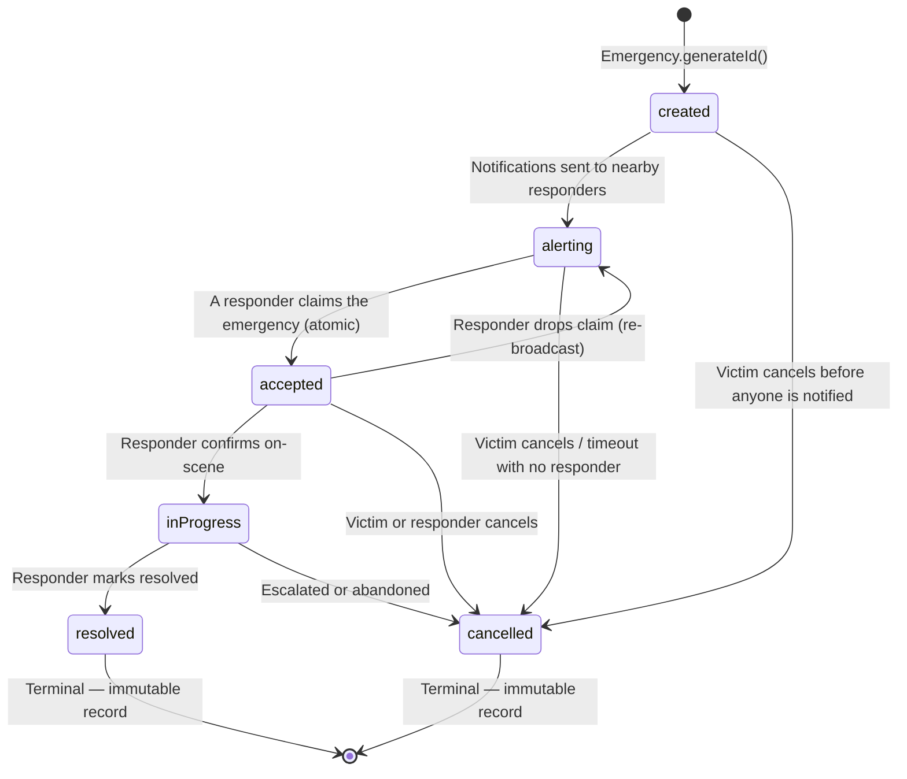

# SafeReach — Architecture Reference

> **Package:** `com.example.safereach`  
> **Platform:** Flutter (iOS & Android)  
> **Phase:** 1 — Project Skeleton, Architecture Rules, Core Domain Models

---

## Table of Contents

1. [System Overview](#1-system-overview)
2. [Folder Structure](#2-folder-structure)
3. [The Central `Emergency` Entity & State Machine](#3-the-central-emergency-entity--state-machine)
4. [The 10 Bug-Prevention Rules](#4-the-10-bug-prevention-rules)
5. [Data Flow](#5-data-flow)
6. [Domain Models Summary](#6-domain-models-summary)
7. [Future Phases Roadmap](#7-future-phases-roadmap)

---

## 1. System Overview

SafeReach is a **Community Emergency Response Platform** that enables civilians and verified responders to coordinate during emergencies — online *and* offline. The architecture is designed around four non-negotiables:

| Non-Negotiable | Design Decision |
|---|---|
| Works without internet | Offline-first with local DB + sync queue |
| GPS never depends on map tiles | Raw coordinates stored independently |
| No duplicate responder claims | Atomic Firestore transactions |
| Honest UX framing | "Possible Crash" instead of definitive "Crash Detected" |

---

## 2. Folder Structure

```
lib/
├── models/           # Pure Dart domain models (no Flutter deps)
│   ├── emergency.dart
│   └── user_profile.dart
├── services/         # Side-effectful I/O: GPS, FCM, local DB, Firestore
│   └── .gitkeep
├── repositories/     # Offline-first data access layer (local + remote)
│   └── .gitkeep
├── providers/        # Riverpod/Provider state management
│   └── .gitkeep
├── screens/          # Route-level UI screens (Phase 2+)
│   └── .gitkeep
└── widgets/          # Reusable UI components (Phase 2+)
    └── .gitkeep

docs/
└── ARCHITECTURE.md   ← this file

test/
└── models/
    └── emergency_test.dart  (Phase 1 unit tests)
```

---

## 3. The Central `Emergency` Entity & State Machine

### 3.1 Entity Fields

| Field | Type | Purpose |
|---|---|---|
| `id` | `String` | Client-generated, format `EMG-2026-XXXXXXXX` |
| `victimId` | `String` | UID of the person who triggered the emergency |
| `latitude` | `double` | WGS-84 decimal degrees |
| `longitude` | `double` | WGS-84 decimal degrees |
| `accuracyMeters` | `double` | GPS fix accuracy in metres |
| `type` | `EmergencyType` | `medical`, `accident`, `safety`, `general` |
| `createdAt` | `DateTime` | UTC creation timestamp |
| `detectionSource` | `DetectionSource` | `manualHelp` or `possibleCrash` |
| `status` | `EmergencyStatus` | Current lifecycle state (see §3.2) |
| `primaryResponderId` | `String?` | UID of the responder who accepted |
| `standbyResponderId` | `String?` | UID of a backup responder |
| `communicationMode` | `CommunicationMode` | `online` or `offline` |
| `version` | `int` | Optimistic concurrency counter |

### 3.2 State Machine



#### Allowed Transitions (enforced by `canTransitionTo()`)

| From | Allowed `nextStatus` values |
|---|---|
| `created` | `alerting`, `cancelled` |
| `alerting` | `accepted`, `cancelled` |
| `accepted` | `inProgress`, `cancelled`, `alerting` |
| `inProgress` | `resolved`, `cancelled` |
| `resolved` | *(none — terminal)* |
| `cancelled` | *(none — terminal)* |

Any call to `canTransitionTo()` for an unlisted transition returns `false`. Callers **must** check this before writing to any database.

---

## 4. The 10 Bug-Prevention Rules

### Rule 1 — Real Reachability vs. No-Wi-Fi

**Problem:** A device may have Wi-Fi connected but no actual internet route. `connectivity_plus` only reports the *link layer* state, not true end-to-end reachability.

**Rule:** Never trust `ConnectivityResult.wifi` or `ConnectivityResult.mobile` alone. Always attempt a lightweight probe (e.g., DNS lookup or HEAD request to a known endpoint) before marking the app as "online". The `CommunicationMode` field on `Emergency` reflects this verified state, not the OS network status.

---

### Rule 2 — Offline-Independent GPS

**Problem:** Many location libraries cache coordinates only while map tiles are loaded, or fail when the Maps SDK is unavailable.

**Rule:** GPS coordinates (`latitude`, `longitude`, `accuracyMeters`) are captured using the `geolocator` package directly against the platform location API — **no map SDK, no tile server, no routing dependency**. Coordinates are stored as plain `double` fields and are valid regardless of network state. The map UI (Phase 2+) renders coordinates onto locally cached tiles; losing tiles never loses the fix.

---

### Rule 3 — Atomic Responder Claims

**Problem:** Two responders tapping "Accept" simultaneously can both believe they are primary responder, causing split responses and coordination failure.

**Rule:** Every responder claim is executed as a **Firestore transaction** that reads and writes `primaryResponderId` atomically. The transaction aborts if `primaryResponderId` is already set. Only the first successful commit wins. The `version` field is incremented on every write; clients that hold a stale version must re-fetch before writing.

---

### Rule 4 — Firestore / Local DB as Source of Truth (Not Push Payloads)

**Problem:** FCM push payloads arrive out of order, may be dropped, and are truncated on some Android OEMs. Building business logic on top of push payload data leads to stale or missing state.

**Rule:** Push notifications carry **only a notification type and the `Emergency` ID** (e.g., `{ "type": "emergency_updated", "emergencyId": "EMG-2026-9F4A2C1B" }`). On receipt, the app always fetches the full record from Firestore (online) or local DB (offline). The push payload is never the authoritative source of emergency state.

---

### Rule 5 — FCM Foreground / Background / Terminated Handling + OS Force-Stop

**Problem:** FCM delivers messages differently depending on app lifecycle state. Android "force stop" (battery saver, OEM optimisations) can prevent the app from ever receiving a push.

**Rule:**
- **Foreground:** `FirebaseMessaging.onMessage` stream — handled in-app.
- **Background (not terminated):** `FirebaseMessaging.onBackgroundMessage` isolate — must be a top-level function, no Flutter engine access.
- **Terminated:** System tray notification tap → `getInitialMessage()` on cold start.
- **Force-stopped / Doze:** Push may never arrive. The app **must** show a persistent "you may miss alerts" banner when background delivery cannot be verified, and must never promise real-time delivery to users on affected devices.

---

### Rule 6 — Single-Lifecycle Listeners Without Duplication

**Problem:** Riverpod providers, `StreamSubscription`s, and `ChangeNotifier`s created in `initState` without disposal cause duplicate event handling and memory leaks, especially during hot reload.

**Rule:**
- Every `StreamSubscription` is stored in a field and cancelled in `dispose()`.
- Riverpod `ref.listen` / `ref.watch` is used instead of manual stream subscriptions wherever possible.
- Global listeners (FCM, connectivity) are registered **once** at app startup in a top-level service and never re-registered on widget rebuild.

---

### Rule 7 — Collision-Resistant `EMG-2026-XXXXXXXX` IDs

**Problem:** Sequential or timestamp-based IDs collide when multiple devices create emergencies offline simultaneously.

**Rule:** Emergency IDs are always generated client-side by `Emergency.generateId()`:

```dart
static String generateId() {
  final rng = Random.secure();
  final bytes = List<int>.generate(4, (_) => rng.nextInt(256));
  final hex = bytes.map((b) => b.toRadixString(16).padLeft(2, '0')).join().toUpperCase();
  return 'EMG-2026-$hex';
}
```

This yields 2³² ≈ 4.3 billion possible values per year prefix. IDs are identical whether created online or offline, so local records merge into Firestore without renaming. The year prefix (`2026`) is a human-readable shard; it can be updated annually.

---

### Rule 8 — Offline Queue & Idempotent Sync

**Problem:** Network writes that fail silently leave the local and remote DBs diverged. Retrying non-idempotent operations (e.g., incrementing a counter) produces incorrect results.

**Rule:**
- Every mutation is written to a **local queue** (SQLite / Hive) before attempting the remote write.
- Each queue entry includes the full target document state (not a delta), making every sync operation a **set/merge**, not an increment.
- The `version` field acts as an optimistic lock. The sync worker checks `version` matches before committing; on conflict, it fetches the latest and re-applies local changes.
- Once the remote write succeeds, the queue entry is deleted atomically.

---

### Rule 9 — Minimal Push Payloads Without Sensitive PII

**Problem:** FCM payloads pass through Google infrastructure and are logged on-device. Embedding victim names, addresses, or medical details in push payloads is a privacy violation and an attack surface.

**Rule:** FCM data payloads contain **only**:
```json
{ "type": "emergency_updated", "emergencyId": "EMG-2026-XXXXXXXX" }
```
No names, no coordinates, no medical type, no phone numbers. The receiving app fetches sensitive data from Firestore over an authenticated, encrypted channel.

---

### Rule 10 — Honest "Possible Crash" Framing

**Problem:** Accelerometer-based crash detection has false positives (dropping a phone, riding a rough road). Labelling these "CRASH DETECTED" panics users and erodes trust.

**Rule:**
- The `DetectionSource.possibleCrash` value is used for sensor-triggered events.
- UI strings always say **"Possible Crash Detected — Are you OK?"** never "Crash Detected".
- The user has a **30-second countdown** to dismiss the alert before an emergency is created.
- In all alert text and notifications, prefer **"HELP"** over "SOS" to match the app's user-facing language standard.

---

## 5. Data Flow

```
[Device Sensors / User Input]
        │
        ▼
  EmergencyRepository.create()
        │
        ├──► Local DB (SQLite/Hive) ◄─── always first, synchronous
        │
        └──► Offline Sync Queue
                    │
            (when online & reachability confirmed)
                    │
                    ▼
             Firestore (remote truth)
                    │
                    ▼
          FCM → other devices
          (payload: type + emergencyId only)
                    │
                    ▼
         Recipient fetches full Emergency
         from Firestore or local replica
```

---

## 6. Domain Models Summary

### `Emergency`
- Enums: `EmergencyType`, `DetectionSource`, `EmergencyStatus`, `CommunicationMode`
- Key methods: `generateId()`, `canTransitionTo()`, `copyWith()`, `toJson()`, `fromJson()`

### `UserProfile`
- Fields: `uid`, `displayName`, `isVerifiedResponder`, `isAvailable`, `responseHistoryCount`, `successfulAssistanceCount`, `reputationPoints`, `badges`
- Key methods: `copyWith()`, `toJson()`, `fromJson()`

---

## 7. Future Phases Roadmap

| Phase | Scope |
|---|---|
| **1** ✅ | Skeleton, architecture rules, `Emergency` + `UserProfile` models |
| **2** | GPS service, offline local DB (Hive/SQLite), EmergencyRepository |
| **3** | Firebase integration, Firestore real-time sync, offline queue |
| **4** | FCM push notifications, background isolate handler |
| **5** | Home screen (HELP button), responder dashboard |
| **6** | Crash detection (accelerometer), "Possible Crash" flow |
| **7** | Reputation, badges, responder leaderboard |
| **8** | Admin portal, analytics |

