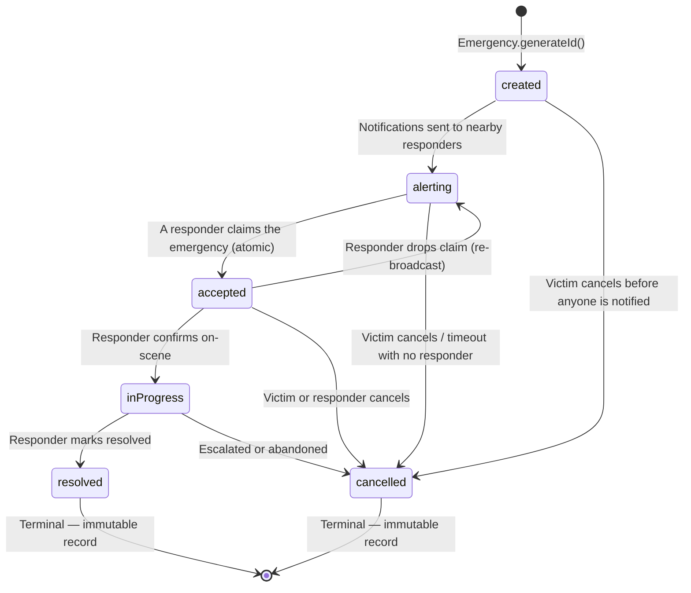

# Vindara — Architecture Reference

> **Package:** `com.vindara.app`  
> **Platform:** Flutter (iOS & Android)  
> **Phase:** 4 — Bulletproof FCM Push Lifecycle, Deep-Link Routing, and Privacy-Minimal Cloud Function

---

## Table of Contents

1. [System Overview](#1-system-overview)
2. [Folder Structure](#2-folder-structure)
3. [The Central `Emergency` Entity & State Machine](#3-the-central-emergency-entity--state-machine)
4. [The 10 Bug-Prevention Rules](#4-the-10-bug-prevention-rules)
5. [Data Flow & Push Notification Architecture](#5-data-flow--push-notification-architecture)
6. [Domain Models Summary](#6-domain-models-summary)
7. [Future Phases Roadmap](#7-future-phases-roadmap)

---

## 1. System Overview

Vindara is a **Community Emergency Response Platform** that enables civilians and verified responders to coordinate during emergencies — online *and* offline. The architecture is designed around four non-negotiables:

| Non-Negotiable | Design Decision |
|---|---|
| Works without internet | Offline-first with local DB + sync queue |
| GPS never depends on map tiles | Raw coordinates stored independently |
| No duplicate responder claims | Atomic Firestore transactions |
| Honest UX framing | "Possible Crash" instead of definitive "Crash Detected" |

---

## 2. Folder Structure

```
functions/
├── package.json
└── index.js          # Firestore trigger for privacy-minimal push alert dispatch

lib/
├── constants/
│   └── platform_limitations.dart
├── models/           # Pure Dart domain models (no Flutter deps)
│   ├── emergency.dart
│   └── user_profile.dart
├── services/         # Side-effectful I/O: GPS, FCM, local DB, Firestore, connectivity, sync
│   ├── local_emergency_store.dart
│   ├── location_service.dart
│   ├── connectivity_service.dart
│   ├── firestore_emergency_service.dart
│   ├── sync_service.dart
│   └── notification_service.dart
├── repositories/     # Offline-first data access layer (local + remote)
│   ├── emergency_repository.dart
│   └── user_profile_repository.dart
├── providers/        # Riverpod state management
│   └── providers.dart
├── screens/          # Route-level UI screens (Phase 5+)
│   └── .gitkeep
└── widgets/          # Reusable UI components (Phase 5+)
    └── .gitkeep

docs/
└── ARCHITECTURE.md   ← this file
```

---

## 3. The Central `Emergency` Entity & State Machine

### 3.1 Entity Fields

| Field | Type | Purpose |
|---|---|---|
| `id` | `String` | Client-generated, format `EMG-2026-XXXXXXXX` |
| `victimId` | `String` | UID of the person who triggered the emergency |
| `latitude` | `double` | WGS-84 decimal degrees |
| `longitude` | `double` | WGS-84 decimal degrees |
| `accuracyMeters` | `double` | GPS fix accuracy in metres |
| `type` | `EmergencyType` | `medical`, `accident`, `safety`, `general` |
| `createdAt` | `DateTime` | UTC creation timestamp |
| `detectionSource` | `DetectionSource` | `manualHelp` or `possibleCrash` |
| `status` | `EmergencyStatus` | Current lifecycle state (see §3.2) |
| `primaryResponderId` | `String?` | UID of the responder who accepted |
| `standbyResponderId` | `String?` | UID of a backup responder |
| `communicationMode` | `CommunicationMode` | `online` or `offline` |
| `version` | `int` | Optimistic concurrency counter |

### 3.2 State Machine



#### Allowed Transitions (enforced by `canTransitionTo()`)

| From | Allowed `nextStatus` values |
|---|---|
| `created` | `alerting`, `cancelled` |
| `alerting` | `accepted`, `cancelled` |
| `accepted` | `inProgress`, `cancelled`, `alerting` |
| `inProgress` | `resolved`, `cancelled` |
| `resolved` | *(none — terminal)* |
| `cancelled` | *(none — terminal)* |

---

## 4. The 10 Bug-Prevention Rules

### Rule 1 — Real Reachability vs. No-Wi-Fi
**Rule:** Never trust `ConnectivityResult.wifi` or `ConnectivityResult.mobile` alone. Always attempt a lightweight probe (`HEAD`/`GET` with 3-second timeout) before marking the app as online. `ConnectivityService` exposes verified `isOnline` stream.

### Rule 2 — Offline-Independent GPS
**Rule:** GPS coordinates (`latitude`, `longitude`, `accuracyMeters`) are captured using the `geolocator` package directly against the platform location API — **no map SDK, no tile server, no routing dependency**. Cached coordinates provide an immediate fallback.

### Rule 3 — Atomic Responder Claims
**Rule:** Responder claims are executed as a **Firestore transaction** (`FirestoreEmergencyService.claimEmergency`):
- First claim assigns `primaryResponderId`, sets `status = accepted`, increments `version`.
- Second concurrent claim assigns `standbyResponderId`, increments `version`.
- Additional claims receive `AlreadyClaimedResult`.
- Releasing primary role automatically promotes standby to primary.

### Rule 4 — Firestore / Local DB as Source of Truth (Not Push Payloads)
**Rule:** Push notifications carry **only a notification type and the `emergencyId`** (e.g. `{ "emergencyId": "EMG-2026-9F4A2C1B", "type": "medical" }`). On notification tap, the app only passes `/emergency/<emergencyId>` into the router. The app fetches authoritative data from Firestore/local DB; push payload data is never used to populate status or victim details.

### Rule 5 — FCM Foreground / Background / Terminated Handling + OS Force-Stop Limitations
**Rule:**
- **Foreground (`onMessage`)**: Emits `InAppAlertEvent` and triggers a local heads-up notification without navigating away while the user is actively working.
- **Background Tap (`onMessageOpenedApp`)**: Emits `/emergency/<id>` to `deepLinkStream`.
- **Terminated Cold-Start (`getInitialMessage`)**: Captured during `NotificationService.init()`, stored in `pendingDeepLinkProvider` to eliminate cold-start router race conditions.
- **Background isolate handler**: Defined as a top-level `@pragma('vm:entry-point')` function.
- **OS Force-Stop / Battery Optimization Notice**: If a user explicitly force-stops the app in Android/iOS settings or enables aggressive power-saver modes, OS platform restrictions block background FCM delivery until the app is reopened. Vindara documents this honestly in `PlatformLimitations.osForceStopLimitationNotice`.

### Rule 6 — Single-Lifecycle Listeners Without Duplication
**Rule:**
- Every `StreamSubscription` is stored in a field and cancelled in `dispose()`.
- Providers (`notificationServiceProvider`, `syncServiceProvider`, `connectivityServiceProvider`) register clean teardowns via `ref.onDispose`. Listeners are never duplicated on rebuilds or hot reload.

### Rule 7 — Collision-Resistant `EMG-2026-XXXXXXXX` IDs
**Rule:** Emergency IDs are generated client-side by `Emergency.generateId()` using `Random.secure()` (4 random bytes = 8 hex chars). IDs are identical offline and online.

### Rule 8 — Offline Queue & Idempotent Sync
**Rule:**
- Mutations write to `LocalEmergencyStore` first (`pending`).
- `SyncService` drains the queue when `isOnline` becomes true, pushing records via `upsertEmergency(emergency)` guarded by `version`.

### Rule 9 — Minimal Push Payloads Without Sensitive PII
**Rule:** FCM data payloads sent by Cloud Functions contain **only**:
```json
{ "emergencyId": "EMG-2026-XXXXXXXX", "type": "medical" }
```
No victim name, no phone number, no address, no coordinates. Sensitive details remain authenticated inside Firestore.

### Rule 10 — Honest "Possible Crash" Framing
**Rule:** Sensor-triggered events use `DetectionSource.possibleCrash` and UI strings always state **"Possible Crash Detected — Are you OK?"** with a 30-second countdown. Never use "SOS" in user-facing UI; use **"HELP"**.

---

## 5. Data Flow & Push Notification Architecture

```
[Victim Device]
        │ (HELP pressed)
        ▼
  EmergencyRepository.create()
        │
        ├──► Local Hive DB (emergencies_box, syncStatus: pending)
        │
        ▼ (when isOnline)
  Firestore (emergencies/{emergencyId}, status: 'alerting')
        │
        ▼ (onDocumentCreated trigger)
  Cloud Function (functions/index.js)
        │
        ├──► Query active verified responders (isAvailable: true, fcmToken != null)
        │
        ▼ (FCM High-Priority Multicast, payload: { emergencyId, type } ONLY)
  FCM Gateway ────► [Nearby Responder Devices]
                         │
        ┌────────────────┼────────────────┐
        ▼ (Foreground)   ▼ (Background)   ▼ (Terminated Cold-Start)
    Heads-up alert    onMessageOpenedApp  getInitialMessage()
    in-app banner     deepLinkStream      pendingDeepLinkProvider
        │                │                │
        └────────────────┴────────────────┴─► Route to /emergency/:id
                                                  │
                                                  ▼
                                       Fetch authoritative record
                                         from Firestore / local DB
```

---

## 6. Domain Models Summary

### `Emergency`
- Enums: `EmergencyType`, `DetectionSource`, `EmergencyStatus`, `CommunicationMode`
- Key methods: `generateId()`, `canTransitionTo()`, `copyWith()`, `toJson()`, `fromJson()`

### `UserProfile`
- Fields: `uid`, `displayName`, `isVerifiedResponder`, `isAvailable`, `responseHistoryCount`, `successfulAssistanceCount`, `reputationPoints`, `badges`, `fcmToken`
- Key methods: `copyWith()`, `toJson()`, `fromJson()`

---

## 7. Future Phases Roadmap

| Phase | Scope |
|---|---|
| **1** ✅ | Skeleton, architecture rules, `Emergency` + `UserProfile` models |
| **2** ✅ | Local Hive store, GPS location service, EmergencyRepository, Riverpod providers |
| **3** ✅ | Vindara rebrand, real reachability probe, Cloud Firestore atomic claims, idempotent sync |
| **4** ✅ | FCM push notification architecture, deep-linking, privacy-minimal Cloud Function |
| **5** ✅ | Home screen (HELP button), 112 official layer, live Emergency Detail screen |
| **6** ✅ | Possible crash detection (sensors_plus), 10s countdown, profile & home monitoring controls |
| **7** ✅ | Nearby offline device-to-device relay, responder rewards, hybrid OSM/offline distance card |
| **8** ✅ | Production Firestore security rules, composite indexes, Teammate AI integration contract, v1.0.0 release |
